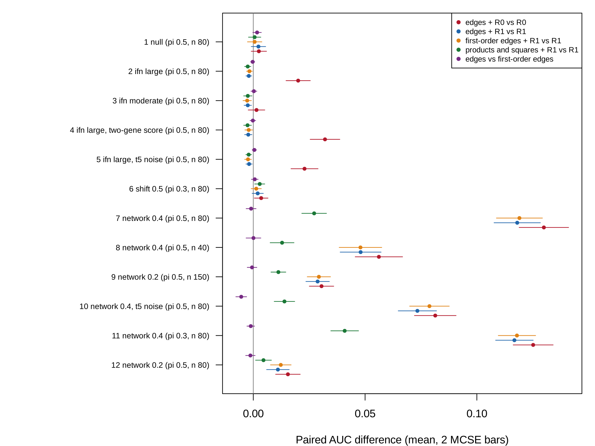

```{r}
#| label: setup
#| include: false

source("../templates/pilot-report/report-helpers.R")
devtools::load_all("..", quiet = TRUE)
s <- readRDS("results/cell_summaries.rds")
v <- readRDS("results/verdict.rds")
ka <- readRDS("results/known_answers.rds")
design <- readRDS("results/design.rds")
run <- readRDS("results/run_info.rds")
s_a <- readRDS("../pilot/results/cell_summaries.rds")
v_a <- readRDS("../pilot/results/verdict.rds")
ph <- readRDS("../pilot/results/posthoc_cell13.rds")
dates <- read.csv("../pilot/gse45291_processing_dates.csv")
cands <- read.csv("../pilot/candidate_datasets.csv", check.names = FALSE)
G <- function(cell, q) s$mean[s$cell == cell & s$quantity == q]
M <- function(cell, q) s$mcse[s$cell == cell & s$quantity == q]
gm <- function(cell, q, d = 3) sprintf("%s (MCSE %s)", fmt(G(cell, q), d), fmt(M(cell, q), 4))
GA <- function(cell, q) s_a$mean[s_a$cell == cell & s_a$quantity == q]
cl <- v$clauses
c1b <- cl[cl$question == 1 & cl$clause == "(b)", ]
c3a <- cl[cl$question == 3 & cl$clause == "(a)", ]
status <- v$status
n_rep <- run$n_rep
minutes <- round(run$elapsed_seconds / 60)
net_cells <- design$cell[design$mechanism == "network"]
ifn_cells <- design$cell[design$mechanism == "ifn"]
cell_lab <- function(cl) {
  d <- design[design$cell == cl, ]
  st <- if (d$stress == "") "" else paste0(", ", d$stress)
  if (d$mechanism == "null") return(sprintf("cell %d (null, share %.1f, %d per class)", cl, d$share, d$n1))
  sprintf("cell %d (%s %s%s, share %.1f, %d in the smaller class)", cl,
          c(ifn = "IFN only", shift = "mean shift", network = "network")[d$mechanism],
          d$level, st, d$share, d$n1)
}
```

# Summary

**Scope.** This document reports the re-pilot[^pilot] for revision 3 of the proposal `proposal.md` (section 12, "after the pilot"), run in `pilot-b/` after the first pilot failed by its rule (`pilot/pilot-report.html`). It covers the revised idea, how the re-pilot was run, what it found, the draft project spec, and the decisions made along the way. It was built from `project-spec.md`, `decisions.md`, the saved results in `pilot-b/results/`, and, read-only, the first pilot's results and its two files of dataset facts in `pilot/`; every number in the text and figures is computed from those files when the document renders.

**Status.** In `STATUS.md` the re-pilot is marked `` `r status` ``[^pf]. Every clause of the pre-registered rule passed except the size of the IFN artifact at a large IFN difference, which landed on its threshold: the estimate is above 0.02, but within three MCSE of it. The reading that passes takes the estimate; the reading that fails notes that the data do not exclude an artifact below 0.02. Neither reading touches the main claims: the exact and first-order edges performed the same in every cell, and the squared score removed the artifact in every IFN-only cell.

| Pilot question | Answer | Key evidence |
|---------|-------------|---------------------------------------------|
| 1. Does the equivalence hold? | Yes | Edges with $R_1$ gained `r gm(7, "gain_N1R1_vs_R1")` over $R_1$ in `r cell_lab(7)`; edges and first-order edges differed by `r fmt_range(c1b$value, 4)` across all `r nrow(design)` cells. |
| 2. Large enough at realistic n? | Signal yes; artifact a close call | The IFN artifact was `r gm(2, "gain_N1R0_vs_R0")` at a large IFN difference; the co-expression signal at 40 per class was `r gm(8, "gain_N1R1_vs_R1")`. |
| 3. Obvious fix or diagnostic? | Yes | With the squared score in the reference, edges added `r fmt_range(c3a$value, 4)` in the IFN-only cells, and `r gm(4, "gain_N1R1_vs_R1", 4)` with a two-gene score. |

**What needs your decision** (details in [Action items and limitations](#action-items-and-limitations)): the status call; the open `[TO CONFIRM]` items in the spec (highlighted in yellow): the PRECISESADS access request and the milestone dates; and the two open items carried from the proposal (the data contingency, and the check of a supplement for the novelty claim).

# The idea

## In plain language

LIONESS[^lioness] gives every patient a value for every pair of genes, called an edge, meant to say how tightly the two genes move together in that patient. The exact formula behind it says what the value is made of: the correlation of the two genes across all patients, plus the product of the patient's own two standardized values, minus a correction for how far each gene alone sits from its average. Take two genes correlated 0.5 across patients and a patient whose two genes sit 2 standard deviations above average: the edge is about $0.5 + 2 \times 2 - 0.25 \times (4 + 4) = 2.5$. That number can be computed from the patient's expression in one line, without building any network.

The first pilot found that edges add little when two diseases differ only in interferon activity, and that adding the squared interferon score to the reference model removes that small gain. It also found that edges pick up a real difference in how genes move together, which a model given the same products and squares as separate inputs missed. The re-pilot asks whether the one-line version (the first-order edge) does everything the full edge does, whether that holds with outlying values, and whether the interferon fix holds when the score is measured less well. What is known: the formula is exact and tested. What is not known: how these results look in real blood, since no patient data were analyzed.

## Potential impact

LIONESS builds one network per sample from an aggregate network and has an R implementation [@kuijjer2019lioness; @kuijjer2019lionessr]. Earlier work reduced per-sample changes in correlation to a product of standardized deviations for large reference sets [@yu2017iena], and documented that subpopulation size and differential expression shift LIONESS edges [@kuijjer2026challenges]. New here: the exact closed form of the LIONESS edge, the test of whether its first-order version replaces it as a classifier input, and the test of the squared-factor fix under stress.

Users compare edges between groups and feed them to classifiers, and read the result as rewired gene coupling. If the first-order edges match the exact edges, a network result is a result about a specific quadratic function of expression that any reader can recompute, and the network computation, which costs one refit per sample, is not needed. If the squared interferon score removes the interferon artifact, a reference model with it becomes the standard check for any edge-based claim in interferon-driven disease.

The re-pilot supports both. Across all `r nrow(design)` cells, the exact and first-order edges differed by `r fmt_range(c1b$value, 4)` in AUC (@fig-gains), including cells where edges gained up to `r fmt(max(sapply(net_cells, G, q = "gain_N1R1_vs_R1")), 3)` over the reference and cells with heavy-tailed noise. With the squared score in the reference, edges added nothing in any IFN-only cell (@tbl-verdict). The same quadratic information given as separate products and squares gained only `r gm(7, "gain_E5_vs_R1")` where the first-order edges gained `r gm(7, "gain_F1R1_vs_R1")` (@tbl-auc), so the edge form is a better way to present co-expression to a penalized classifier. The application to PRECISESADS, once access is granted, will show whether these hold in real blood.

## Application: the study behind the data

### The study

The proposed data come from PRECISESADS, a European study of systemic autoimmune diseases [@barturen2021precisesads], https://doi.org/10.1002/art.41610. It recruited a cross-sectional cohort of 955 patients with seven systemic autoimmune diseases, among them systemic lupus erythematosus (SLE) and rheumatoid arthritis (RA), and 267 healthy controls, from 18 centres, and measured the whole-blood transcriptome[^transcriptome], the DNA methylome, blood cell proportions by flow cytometry[^flow], and the treatment each patient was taking. Its main finding was that patients cluster into four molecular groups that cut across diagnoses, one of them defined by an interferon (IFN)[^ifn] pattern shared by several diseases. The data are held by ELIXIR Luxembourg under controlled access (dataset ELU-2-E592B0-1, https://doi.org/10.17881/th9v-xt85) for non-commercial research on systemic autoimmune diseases [@precisesads2017data]. Access has not yet been requested, so no PRECISESADS data were opened.

A search of the Gene Expression Omnibus[^geo] for public series with both SLE and RA in blood found no usable alternative (@tbl-cohort). The largest, GSE45291, holds both diseases on one platform, but every processing date holds one disease only (@fig-data).

```{r}
#| label: tbl-cohort
#| tbl-cap: "Candidate datasets with SLE and RA from one study, from `pilot/candidate_datasets.csv` (GEO series and sample records and the PRECISESADS landing page, opened 2026-11-03). Empty cells: not stated in the record read."

knitr::kable(cands[, c("dataset", "sample_type", "sle", "ra", "controls", "usable", "reason")],
             col.names = c("Dataset", "Samples", "SLE", "RA", "Controls", "Usable", "Reason"),
             row.names = FALSE)
```

### Why the AUC difference between edges and first-order edges

The quantity that decides the revised claim is the difference in out-of-sample area under the ROC curve[^auc] (AUC) between a classifier given the exact LIONESS edges and one given the first-order edges, each with the reference model $R_1$ (clinical covariates, composition, the residual IFN score, and their squares). A difference near zero, in cells where edges carry a real signal, means the network adds nothing beyond a formula of the patient's expression. The proposed analysis tests it as an equivalence, with a margin of 0.01 in AUC, in repeated nested cross-validation[^cv] on PRECISESADS.

### Did the original study compute it?

No. The PRECISESADS analysis clustered patients on transcriptome and methylome features and characterized the clusters; it built no single-sample networks and fitted no classifier of SLE against RA. The question is new for these data.

## In symbols

The sample's standardized expression of gene $i$ ($z_{qi}$, its deviation from the reference mean in units of the reference standard deviation, divisor $N$) and the reference correlation of genes $i$ and $j$ ($r$) determine the LIONESS edge of sample $q$ ($e_q$), with $a = 1/(N-1)$, and its first-order form ($f_q$):

$$
\begin{aligned}
e_q &= N r - (N-1)\, \frac{r - a\, z_{qi} z_{qj}}{\sqrt{(1 - a z_{qi}^2)(1 - a z_{qj}^2)}} \\
f_q &= r + z_{qi} z_{qj} - \frac{r}{2}\left(z_{qi}^2 + z_{qj}^2\right) \\
e_q &= f_q + O_p(1/N).
\end{aligned}
$$

| Symbol | Meaning |
|----|------------------------------|
| $N$ | number of samples in the reference set |
| $z_{qi}$ | expression of gene $i$ in sample $q$, standardized by the reference (divisor $N$) |
| $r$ | Pearson correlation of genes $i$ and $j$ in the reference |
| $e_q$ | exact LIONESS edge of sample $q$ for the pair $(i, j)$ |
| $f_q$ | first-order edge: the reference correlation plus the influence function of the correlation at the sample |

A classifier on $e_q$ and one on $f_q$ use the same information to first order. The first-order edges are a linear combination of the products $z_{qi} z_{qj}$ and squares $z_{qi}^2$; a penalized classifier given the products and squares as separate inputs fits the same span of functions, but its penalty acts on different coefficients.

```{r}
#| label: fig-idea
#| fig-cap: "The idea, an illustration on made-up numbers (not re-pilot output): 300 simulated samples of two genes correlated 0.5, with normal noise (left) and heavy-tailed noise (t with 5 degrees of freedom, right). Each point is one sample's exact LIONESS edge against its first-order edge; the line is equality."
#| fig-width: 10
#| fig-height: 4.2

set.seed(21)
n <- 300
mk <- function(e) cbind(e[, 1], 0.5 * e[, 1] + sqrt(0.75) * e[, 2])
xn <- mk(matrix(rnorm(2 * n), n))
xt <- mk(matrix(rt(2 * n, 5) / sqrt(5 / 3), n))
par(mfrow = c(1, 2), mar = c(4.2, 4.2, 2, 1))
for (k in 1:2) {
  x <- list(xn, xt)[[k]]
  plot(LionessEdgesFirstOrder(x)[, 1], LionessEdges(x)[, 1], pch = 19, cex = 0.5, col = "#2166AC",
       xlab = "First-order edge", ylab = "Exact LIONESS edge", main = c("Normal noise", "t5 noise")[k])
  abline(0, 1, col = "grey40")
}
```

```{r}
#| label: fig-data
#| fig-cap: "Real data: GSE45291, the largest public series with SLE and RA in whole blood. Each bar is one processing date (read from the date prefix of the sample titles) and its samples by group, from `pilot/gse45291_processing_dates.csv`. No date holds more than one group."
#| fig-width: 9
#| fig-height: 4.2

tab <- xtabs(n_samples ~ date_from_title + group, data = dates)
par(mar = c(6.5, 4.2, 1, 1))
barplot(t(tab), las = 2, cex.names = 0.7, col = c("grey60", "#1B7837", "#B2182B", "#2166AC"),
        ylab = "Samples", legend.text = colnames(tab), args.legend = list(x = "topleft", bty = "n", cex = 0.8))
```

## Critiquing the model



| Feature of the model | Why it may not be realistic | What should be done to check it |
|-----------|----------------------------------------------|---------------------------------|
| Noise $\varepsilon$ normal or $t_5$ | Log expression has outliers of other shapes (zero inflation, single extreme samples), and the remainder $e_q - f_q$ grows with $z^4$ | Resample real-data residuals in place of $\varepsilon$, and add single-sample outliers of 5 to 10 standard deviations |
| One factor $F$ with equal loadings $a_g$ = 0.8 on 20 genes | Real IFN-stimulated genes respond with different strengths and to several IFN types | Estimate the loadings and the number of IFN factors from PRECISESADS and simulate with them |
| The IFN score as the mean of five or two genes | The score measures $F$ with error, so $R_1$ cannot remove all of $F^2$ | Vary the score's reliability continuously and report the edges' gain over $R_1$ against it |
| Composition $C$ as one factor, observed without error | Whole blood has several cell types whose shares enter the edges as $F^2$ does | Use the flow-cytometry proportions of PRECISESADS with several cell types |
| Elastic net with $\alpha$ = 0.5 for every feature set | The gap between edge features and separate products and squares is a property of the penalty, so it may change with $\alpha$ or with a ridge or lasso penalty | Repeat the network cells with $\alpha$ of 0, 0.5, and 1 |
| The parameter values (IFN difference, correlation change) | Chosen to span small to large effects, not estimated from blood | Place PRECISESADS on each gradient |
| A fixed gene set of 45 genes, 990 edges | Studies select genes by variance or pathway and use thousands of edges | Repeat with selection inside each training fold and larger gene sets |

# Methods

## Design

The re-pilot simulates two classes of 50 genes in 12 cells, from the first pilot's mechanism: genes 1 to 20 load on an IFN factor $F$, the IFN score is the mean of genes 1 to 5 (genes 1 and 2 in one cell), genes 21 to 30 form a co-expressed module, and genes 31 to 50 load on a composition factor $C$. Each cell lets the classes differ in one way: not at all, in the distribution of $F$, in the means of the module genes, or in the module's correlation. Two cells replace normal noise by heavy-tailed noise. In each replicate, seven models are fitted in an outer 5-fold cross-validation, with every derived quantity computed inside the training fold.

```{r}
#| label: fig-design
#| fig-cap: "The design at a glance. Each row is one part of the re-pilot, read from left to right: what is simulated, which factors are varied, what is estimated, what is measured, and how the result is shown. The input is a simulated cohort of 50 genes with an IFN factor, a composition factor, and a co-expressed module. Every part feeds the AUC table (@tbl-auc) and the figure of differences (@fig-gains); the verdict is in @tbl-verdict, and the known-answer checks in @tbl-known-answer."
#| fig-width: 11
#| fig-height: 5.6

design_diagram(
  input = "Simulated cohort: 50 genes; IFN factor F on genes 1-20 (score: genes 1-5, or 1-2); module of genes 21-30; composition C on genes 31-50",
  lanes = list(
    list(label = "Part A: null and IFN only", fill = "#e8f0fa", sim = "Classes differ in the mean and spread of F, or not at all", vary = "IFN difference; noise; score genes", est = "AUC of R0, R1, E1, E5, F1, edges + R0, edges + R1", meas = "Edges against F1; edges + R0 over R0; edges + R1 over R1", out = "Questions 1(b), 2(a), 3: AUC table, figure"),
    list(label = "Part B: mean shift", fill = "#fdeceb", sim = "Class 1 shifted 0.5 SD on the module genes", vary = "Share 0.3", est = "The same seven models", meas = "Edges against F1; edge difference against equation (3)", out = "Question 1(b); known-answer table"),
    list(label = "Part C: network", fill = "#eaf5ea", sim = "Module correlation 0.3 in class 0, higher in class 1", vary = "Correlation change; noise; share; size", est = "The same seven models", meas = "Edges + R1 over R1; edges against F1; F1 against E5", out = "Questions 1(a), 1(b), 2(b): AUC table, figure")),
  harness = list(text = "Known-answer checks: exact edge = leave-one-out LIONESS; add-one edge = definition; AUC on known cases;\nthe null cell gives AUC 0.5; mean-shift edge difference = equation (3)", out = "Known-answer table"))
```

Each figure and table in the Results traces back to one row of this diagram, and the row says what its points or entries represent.

| Part | What is simulated | Main factors | Replicates |
|----|-------------------------|-------------------------|----------|
| A | Null (cell 1) and IFN only (cells 2 to 5) | IFN difference (moderate, large); $t_5$ noise; two-gene score | `r n_rep` per cell |
| B | Mean shift of 0.5 SD on the module (cell 6) | share 0.3, 80 in the smaller class | `r n_rep` per cell |
| C | Module correlation change (cells 7 to 12) | change 0.2 or 0.4; $t_5$ noise; share 0.5 or 0.3; 40, 80, or 150 in the smaller class | `r n_rep` per cell |

The seven models are: $R_0$, logistic regression on age, sex, composition, and the residual IFN score; $R_1$, $R_0$ plus the squared residual score and squared composition; E1, an elastic net[^enet] on the 45 non-score genes; E5, an elastic net on the 990 pairwise products and 45 squares of the standardized genes; F1, an elastic net on the 990 first-order edges; and the edge models, an elastic net on the 990 exact LIONESS edges, with $R_0$ or with $R_1$. In every elastic net the reference covariates are unpenalized. The large IFN difference shifts the mean of $F$ by 1 standard deviation and multiplies its spread by 2.25 in class 1, the moderate one by 0.5 and 1.5. The $t_5$ noise is drawn from a $t$ distribution with 5 degrees of freedom, scaled to unit variance.

## Known-answer checks



```{r}
#| label: tbl-known-answer
#| tbl-cap: "Known-answer checks, from `results/known_answers.rds`."

rows <- lapply(seq_len(nrow(ka)), function(i) {
  k <- ka[i, ]
  if (k$type == "identity") {
    tol <- if (grepl("First-order", k$check)) 0.05 else 1e-8
    harness_row(k$check, k$setting, fmt(k$known, 3), formatC(k$computed, format = "g", digits = 3),
                harness_reading_tol(k$computed, k$known, tol))
  } else {
    harness_row(k$check, k$setting, fmt(k$known, 3), sprintf("%s (MCSE %s)", fmt(k$computed, 4), fmt(k$mcse, 4)),
                harness_reading_mcse(k$computed, k$known, k$mcse))
  }
})
harness_table(rows)
```

`r harness_flag_summary((ka$computed - ka$known)[ka$type == "mcse"] / ka$mcse[ka$type == "mcse"])`

# Results

## How to read the outputs



This re-pilot reports AUC and paired AUC differences. A paired difference is computed within each replicate, between two models fitted to the same simulated cohort, and then averaged; its MCSE is the replicate standard deviation of the difference divided by the square root of the number of replicates. A difference of 0 means the two models did equally well.

## AUC differences by cell

**Figure guide (all parts).** Each row is one cell, labelled by its mechanism, level, stress factor if any, share of the smaller class ($\pi$), and size of the smaller class ($n$). The five colored points are paired AUC differences averaged over `r n_rep` replicates: edges with $R_0$ against $R_0$; edges with $R_1$ against $R_1$; first-order edges with $R_1$ against $R_1$; products and squares with $R_1$ against $R_1$; and edges against first-order edges. The bars are two MCSE on each side, and the grey line is no difference. Look for: whether the purple points sit on the line in every row; whether the blue and orange points coincide; where the green points fall short of them.

```{r}
#| label: fig-gains
#| fig-cap: "Re-pilot result (all parts): paired AUC differences by cell, means over replicates with bars of two MCSE, from `results/cell_summaries.rds`."
#| fig-width: 10
#| fig-height: 7.5


```

## Numbered findings

Each finding is a claim followed by the output behind it. Read the claim, open the output, and check that you can see the claim there before accepting it. A claim that cannot be seen in the output is a question to raise with the user.

1. **Exact and first-order edges perform the same.** Their AUC difference ranged over `r fmt_range(c1b$value, 4)` across all `r nrow(design)` cells (@tbl-verdict, purple points in @fig-gains), within the pre-registered margin of 0.01 in every cell. The largest difference, `r gm(10, "diff_N1R1_vs_F1R1", 4)`, was in `r cell_lab(10)`, and favored the first-order edges.
2. **There was a real signal to match.** In `r cell_lab(7)`, edges with $R_1$ gained `r gm(7, "gain_N1R1_vs_R1")` over $R_1$, and `r gm(8, "gain_N1R1_vs_R1")` with 40 in the smaller class (@tbl-verdict).
3. **The squared score removes the IFN artifact.** Edges with $R_1$ against $R_1$ ranged over `r fmt_range(c3a$value, 4)` in the IFN-only cells with five score genes, and was `r gm(4, "gain_N1R1_vs_R1", 4)` with a two-gene score (@tbl-verdict, blue points).
4. **Without the squared score, the artifact is about 0.02 at a large IFN difference.** Edges with $R_0$ gained `r gm(2, "gain_N1R0_vs_R0", 4)` over $R_0$ in `r cell_lab(2)`, on the threshold of 0.02 (a close call), `r gm(4, "gain_N1R0_vs_R0")` with the two-gene score, `r gm(5, "gain_N1R0_vs_R0")` with $t_5$ noise, and `r gm(3, "gain_N1R0_vs_R0", 4)` at a moderate IFN difference (red points).
5. **The edge form beats separate products and squares.** In the network cells, first-order edges gained over E5 by `r fmt_range(sapply(net_cells, G, q = "diff_F1R1_vs_E5"), 3)`, although both hold the same quadratic information (@tbl-auc, orange against green points).
6. **A mean shift is linear information neither quadratic form carries.** In `r cell_lab(6)`, E1 gained `r gm(6, "gain_E1_vs_R1")` over $R_1$, edges `r gm(6, "gain_N1R1_vs_R1", 4)` (@tbl-auc).
7. **The known-answer checks hold, with one flag.** Every code identity agreed to better than $10^{-13}$ and the mean-shift formula held; in the null cell every model's AUC sat `r fmt_range((0.5 - ka$computed[grepl("Null", ka$check)]) / ka$mcse[grepl("Null", ka$check)], 1)` MCSE below 0.5, shared by all models, so the paired differences are unaffected (@tbl-known-answer; decisions log, D6).

## Tables

**Table guide (all parts).** One row per cell; the columns are the mean out-of-fold AUC of each model over `r n_rep` replicates. The reference value is 0.5 in the null cell. Compare the edges with $R_1$ against F1 in the same row, and both against E5.

```{r}
#| label: tbl-auc
#| tbl-cap: "Mean out-of-fold AUC by cell and model, from `results/cell_summaries.rds`. The largest MCSE of any entry is given in the text below the table."

models <- c("R0", "R1", "E1", "E5", "F1R1", "N1R0", "N1R1")
tab <- data.frame(Cell = sapply(design$cell, cell_lab))
for (m in models) tab[[m]] <- fmt(sapply(design$cell, G, q = m), 3)
names(tab) <- c("Cell", "R0", "R1", "E1 (genes)", "E5 (products, squares)", "F1 (first-order edges)", "Edges + R0", "Edges + R1")
knitr::kable(tab, row.names = FALSE)
```

The largest MCSE of an AUC in the table is `r fmt(max(s$mcse[s$quantity %in% models]), 4)`.

**Table guide (the verdict).** One row per clause of the pre-registered rule: the quantity, its value with its MCSE, the threshold, and the outcome, read by `pilot-b/verdict.R`. Check that each outcome follows from its value and threshold, and that the combination gives the status.

```{r}
#| label: tbl-verdict
#| tbl-cap: "The pass rule applied clause by clause, from `results/verdict.rds`."

vt <- cl
vt$cell <- sapply(vt$cell, cell_lab)
vt$value <- fmt(vt$value, 4)
vt$mcse <- fmt(vt$mcse, 4)
knitr::kable(vt[, c("question", "clause", "cell", "quantity", "value", "mcse", "threshold", "outcome")],
             col.names = c("Q", "Clause", "Cell", "Quantity", "Value", "MCSE", "Threshold", "Outcome"),
             row.names = FALSE)
```

**Table guide (numbers quoted in the spec).** Each row recomputes a number that section 3 of the spec quotes, from the result files.

```{r}
#| label: tbl-spec-numbers
#| tbl-cap: "Numbers quoted in the spec's section 3 for the re-pilot, recomputed from `results/cell_summaries.rds` and `results/verdict.rds`."

knitr::kable(data.frame(
  Quantity = c("1(a): gain of edges + R1 over R1, cell 7",
               "1(b): range of A(edges + R1) - A(F1 + R1) over all cells",
               "2(a): gain of edges + R0 over R0, cell 2",
               "2(b): gain of edges + R1 over R1, cell 8",
               "3(a): range of the gain of edges + R1 over R1, cells 2, 3, 5",
               "3(b): gain of edges + R1 over R1, cell 4",
               "Status"),
  Value = c(gm(7, "gain_N1R1_vs_R1", 4), fmt_range(c1b$value, 4), gm(2, "gain_N1R0_vs_R0", 4),
            gm(8, "gain_N1R1_vs_R1", 4), fmt_range(c3a$value, 4), gm(4, "gain_N1R1_vs_R1", 4), status)),
  row.names = FALSE)
```

# The draft spec {#draft-spec}

This is `project-spec.md`, read from the file when the document renders. Anything the agent[^agent] left for the user to decide is highlighted in yellow and starts with "To confirm".

```{r}
#| label: spec
#| results: asis

cat(read_md_part("../project-spec.md", highlight_to_confirm = TRUE), "\n")
```

# Decisions log {#decisions-log}

This is the agent's `decisions.md` for the re-pilot, read from the file when the document renders.

```{r}
#| label: decisions
#| results: asis

cat(read_md_part("decisions.md"), "\n")
```

# Action items and limitations {#action-items-and-limitations}

## Action items

1. **Decide the status.** The rule gives `piloted-close-call`, from the size of the IFN artifact alone. Reading it as a pass starts stage 3, whose design stop writes `protocol.md` from the revised design.
2. **Resolve the yellow `[TO CONFIRM]` items** in the spec: the PRECISESADS access request and the milestone dates.
3. **Verify the citations.** Every citation was checked against its Crossref or PubMed record and read in full text at stage 1, except @devlin1975robust and @croux2010influence, whose full texts are pending.
4. **Decide on fold-averaged AUC** beside pooled AUC for stage 3 (decisions log, D6).

## Limitations

- Everything here is simulation under one IFN factor with equal loadings and one composition factor; no patient data were analyzed.
- Six of the 18 models of the revised design were run.
- The equivalence of exact and first-order edges was tested with one penalty ($\alpha$ = 0.5) and one heavy-tailed distribution.
- The IFN score's reliability took two values (five genes and two genes), not a range.



[^lioness]: LIONESS (Linear Interpolation to Obtain Network Estimates for Single Samples) builds a network from all samples and again without one sample, and scales the difference to give that sample's network.

[^transcriptome]: The transcriptome is the set of RNA molecules in a sample; here, the expression level of each gene in whole blood, measured by RNA sequencing.

[^flow]: Flow cytometry counts cells by their surface markers, which gives the proportions of B cells, T cells, monocytes, and neutrophils in a blood sample.

[^ifn]: Type I interferons are signaling proteins of the immune response; many SLE patients, and some RA patients, have high blood expression of the genes they induce (the IFN signature), summarized by an IFN score.

[^geo]: The Gene Expression Omnibus is the public archive of gene expression data run by the US National Center for Biotechnology Information.

[^auc]: The area under the ROC curve is the probability that a randomly chosen SLE patient gets a higher score than a randomly chosen RA patient; 0.5 is chance and 1 is perfect separation.

[^cv]: In cross-validation the data are split into folds, each model is fitted without one fold and scored on it, and the scores are pooled; nested cross-validation tunes the model inside each training part, so that the held-out fold is never used for any choice.

[^enet]: The elastic net is logistic regression with a penalty that shrinks coefficients and sets many to zero, so it can use more features than samples; glmnet is the R package that fits it.
