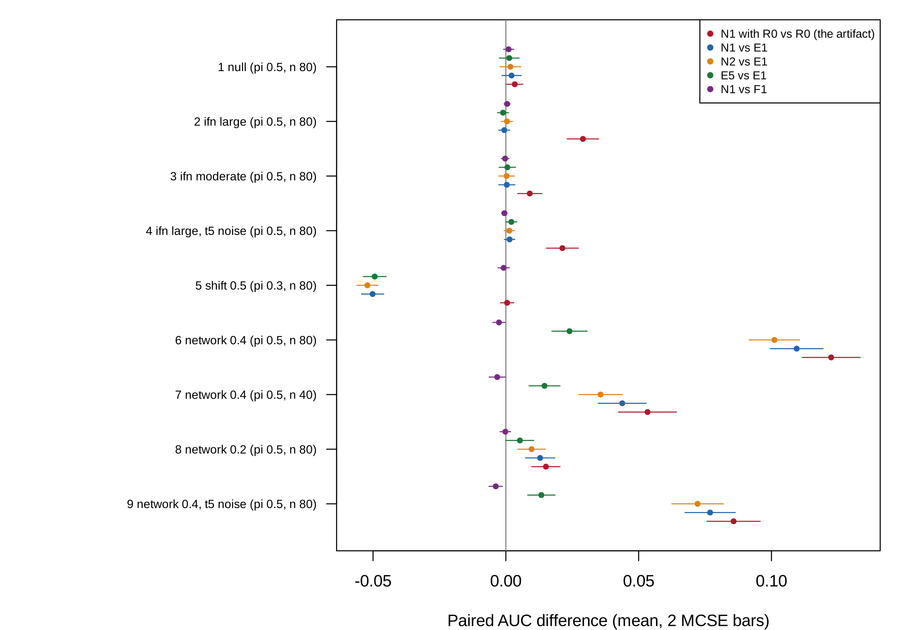

```{r}
#| label: setup
#| include: false

source("../templates/pilot-report/report-helpers.R")
devtools::load_all("..", quiet = TRUE)
s <- readRDS("results/cell_summaries.rds")
v <- readRDS("results/verdict.rds")
ka <- readRDS("results/known_answers.rds")
design <- readRDS("results/design.rds")
run <- readRDS("results/run_info.rds")
s_b <- readRDS("../pilot-b/results/cell_summaries.rds")
G <- function(cell, q) s$mean[s$cell == cell & s$quantity == q]
M <- function(cell, q) s$mcse[s$cell == cell & s$quantity == q]
gm <- function(cell, q, d = 3) sprintf("%s (MCSE %s)", fmt(G(cell, q), d), fmt(M(cell, q), 4))
GB <- function(cell, q) s_b$mean[s_b$cell == cell & s_b$quantity == q]
MB <- function(cell, q) s_b$mcse[s_b$cell == cell & s_b$quantity == q]
cl <- v$clauses
c1b <- cl[cl$question == 1 & cl$clause == "(b)", ]
c3a <- cl[cl$question == 3 & cl$clause == "(a)", ]
c3b <- cl[cl$question == 3 & cl$clause == "(b)", ]
status <- v$status
n_rep <- run$n_rep
minutes <- round(run$elapsed_seconds / 60)
net_cells <- design$cell[design$mechanism == "network"]
ifn_cells <- design$cell[design$mechanism == "ifn"]
outcome <- function(q, c) {
  o <- cl$outcome[cl$question == q & cl$clause == c]
  if (any(o == "fail")) "fail" else if (any(o == "close")) "close call" else "pass"
}
cell_lab <- function(cl) {
  d <- design[design$cell == cl, ]
  st <- if (d$stress == "") "" else paste0(", ", d$stress)
  if (d$mechanism == "null") return(sprintf("cell %d (null, share %.1f, %d per class)", cl, d$share, d$n1))
  sprintf("cell %d (%s %s%s, share %.1f, %d in the smaller class)", cl,
          c(ifn = "IFN only", shift = "mean shift", network = "network")[d$mechanism],
          d$level, st, d$share, d$n1)
}
```

# Summary

**Scope.** This document reports the third pilot[^pilot], for revision 4 of the proposal (`proposal.md`, section 12): the user's new idea, in which every richer model is built on E1, the model with the IFN score, its square, composition, and the gene levels. It covers the idea, how the pilot was run, what it found, the project spec, and the decisions made along the way. It was built from `project-spec.md`, `decisions.md`, the saved results in `pilot-c/results/`, and, read-only, the second pilot's results in `pilot-b/results/`; every number in the text and figures is computed from those files when the document renders.

**Status.** In `STATUS.md` the third pilot is marked `` `r status` ``[^pf]. SUMMARY_STATUS

| Pilot question | Answer | Key evidence |
|---------|-------------|---------------------------------------------|
| 1. Does the equivalence hold on the E1 base? | `r outcome(1, "(a)")` and `r outcome(1, "(b)")` | N1 gained `r gm(6, "d1_N1E1_vs_E1")` over E1 in `r cell_lab(6)`; N1 and F1 differed by `r fmt_range(c1b$value, 4)` across all `r nrow(design)` cells. |
| 2. Does the signal survive at a small size and in N2? | `r outcome(2, "(a)")` and `r outcome(2, "(b)")` | N1 gained `r gm(7, "d1_N1E1_vs_E1")` over E1 at 40 per class; N2 gained `r gm(6, "g2_N2E1_vs_E1")` over E1 in cell 6. |
| 3. Does the E1 base remove the artifact? | `r outcome(3, "(a)")` and `r outcome(3, "(b)")` | In the IFN-only cells, N1 against E1 ranged over `r fmt_range(c3a$value, 4)` and N2 against E1 over `r fmt_range(c3b$value, 4)`. |

**What needs your decision** (details in [Action items and limitations](#action-items-and-limitations)): the status call; the open `[TO CONFIRM]` items in the spec (highlighted in yellow): the PRECISESADS access request, the replication downloads, and the milestone dates.

# The idea

## In plain language

LIONESS[^lioness] gives every patient a value for every pair of genes, called an edge, meant to say how tightly the two genes move together in that patient. The exact formula behind it says what the value is made of: the correlation of the two genes across all patients, plus the product of the patient's own two standardized values, minus a correction for how far each gene alone sits from its average. So an edge can be computed from the patient's expression in one line.

The new idea asks LIONESS to beat a stronger opponent than before. In the earlier pilots, LIONESS edges were added to a model with the interferon score and its square ($R_1$). Now they are added to a model that also holds every gene's level (E1), and each competitor (the one-line formula F1, the separate products and squares E5, and the partial-correlation edges N2) is added to the same E1. This pilot asks whether the earlier findings survive that change: whether edges still equal their formula, whether they still find a real change in co-expression, and whether interferon still leaks through when the gene levels are in the base. No patient data were analyzed.

## Potential impact

LIONESS builds one network per sample from an aggregate network and has an R implementation [@kuijjer2019lioness; @kuijjer2019lionessr]. Earlier work reduced per-sample changes in correlation to a product of standardized deviations for large reference sets [@yu2017iena], and documented that subpopulation size and differential expression shift LIONESS edges [@kuijjer2026challenges]. New here: the exact closed form of the LIONESS edge, and the test of whether edges add anything to a classifier that already holds the gene levels, beyond their own first-order formula.

IMPACT_PARAGRAPH

## Application: the study behind the data

### The study

The proposed data come from PRECISESADS, a European study of systemic autoimmune diseases [@barturen2021precisesads], https://doi.org/10.1002/art.41610. It recruited a cross-sectional cohort of 955 patients with seven systemic autoimmune diseases, among them systemic lupus erythematosus (SLE) and rheumatoid arthritis (RA), and 267 healthy controls, from 18 centres, and measured the whole-blood transcriptome[^transcriptome], blood cell proportions by flow cytometry[^flow], and the treatment each patient was taking; a separate inception cohort was followed over time. The data are held by ELIXIR Luxembourg under controlled access (dataset ELU-2-E592B0-1, https://doi.org/10.17881/th9v-xt85) [@precisesads2017data]. Access has not yet been requested, so no PRECISESADS data were opened. Two public series, GSE17755 and GSE235508, will be used to replicate the simulation's findings inside each dataset; they have not been downloaded.

### Why the AUC difference between N1 and E1

The quantity that decides the new claim is the difference in out-of-sample area under the ROC curve[^auc] (AUC) between E1 plus LIONESS edges (N1) and E1 alone. A difference near zero means the edges add nothing to the gene levels, the IFN score, and its square. Beside it, the difference between N1 and E1 plus the first-order edges (F1) asks whether whatever edges add is their formula. The proposed analysis tests the first as a superiority and the second as an equivalence (margin 0.01), in repeated nested cross-validation[^cv] on PRECISESADS.

### Did the original study compute it?

No. The PRECISESADS analysis clustered patients on transcriptome and methylome features; it built no single-sample networks and fitted no classifier of SLE against RA.

## In symbols

The sample's standardized expression of gene $i$ ($z_{qi}$, its deviation from the reference mean in units of the reference standard deviation, divisor $N$) and the reference correlation of genes $i$ and $j$ ($r$) determine the LIONESS edge of sample $q$ ($e_q$), with $a = 1/(N-1)$, and its first-order form ($f_q$):

$$
\begin{aligned}
e_q &= N r - (N-1) \frac{r - a\, z_{qi} z_{qj}}{\sqrt{\left(1 - a\, z_{qi}^2\right)\left(1 - a\, z_{qj}^2\right)}}, \\
f_q &= r + z_{qi} z_{qj} - \frac{r}{2}\left(z_{qi}^2 + z_{qj}^2\right), \\
e_q &= f_q + O_p\left(N^{-1}\right).
\end{aligned}
$$

| Symbol | Meaning |
|----|------------------------------|
| $N$ | number of samples in the reference set |
| $z_{qi}$ | expression of gene $i$ in sample $q$, standardized by the reference (divisor $N$) |
| $r$ | Pearson correlation of genes $i$ and $j$ in the reference |
| $e_q$ | exact LIONESS edge of sample $q$ for the pair $(i, j)$ |
| $f_q$ | first-order edge: the reference correlation plus the influence function of the correlation at the sample |

The partial-correlation edge of N2 replaces $r$ by the partial correlation of the two genes given the IFN score and composition, computed from residuals, with the same leave-one-out construction.

## Critiquing the model



| Feature of the model | Why it may not be realistic | What should be done to check it |
|-----------|----------------------------------------------|---------------------------------|
| Noise $\varepsilon$ normal or $t_5$ | Log expression has outliers of other shapes, and the remainder $e_q - f_q$ grows with $z^4$ | Resample real-data residuals in place of $\varepsilon$, and add single-sample outliers |
| One factor $F$ with equal loadings $a_g$ = 0.8 on 20 genes | Real IFN-stimulated genes respond with different strengths and to several IFN types | Estimate the loadings and the number of IFN factors from PRECISESADS |
| The IFN score as the mean of five genes | The score measures $F$ with error, so neither E1 nor N2's conditioning can remove all of $F^2$ | Vary the score's reliability in the full study (2, 5, 10 genes) |
| Composition $C$ as one factor, observed without error | Whole blood has several cell types | Use the flow-cytometry proportions of PRECISESADS |
| The gene levels in E1 carry no class signal in the IFN and network cells | In blood, genes differ in level between SLE and RA, so E1 will be a stronger base than here | Place PRECISESADS on each gradient and report E1 over $R_1$ |
| A fixed gene set of 45 genes, 990 edges | Studies select genes by variance or pathway and use thousands of edges | Selection inside each training fold in the application |

# Methods

## Design

The pilot simulates two classes of 50 genes in `r nrow(design)` cells, from the earlier pilots' mechanism: genes 1 to 20 load on an IFN factor $F$, the IFN score is the mean of genes 1 to 5, genes 21 to 30 form a co-expressed module, and genes 31 to 50 load on a composition factor $C$. Each cell lets the classes differ in one way: not at all, in the distribution of $F$, in the means of the module genes, or in the module's correlation. Two cells replace normal noise by heavy-tailed noise. In each replicate, nine models are fitted in an outer 5-fold cross-validation, with every derived quantity computed inside the training fold.

```{r}
#| label: fig-design
#| fig-cap: "The design at a glance. Each row is one part of the pilot, read from left to right: what is simulated, which factors are varied, what is estimated, what is measured, and how the result is shown. Every part feeds the AUC table (@tbl-auc) and the figure of differences (@fig-gains); the verdict is in @tbl-verdict, and the known-answer checks in @tbl-known-answer."
#| fig-width: 11
#| fig-height: 5.6

design_diagram(
  input = "Simulated cohort: 50 genes; IFN factor F on genes 1-20 (score: genes 1-5); module of genes 21-30; composition C on genes 31-50",
  lanes = list(
    list(label = "Part A: null and IFN only", fill = "#e8f0fa", sim = "Classes differ in the mean and spread of F, or not at all", vary = "IFN difference; noise", est = "AUC of R0, R1, E1, E4, E5, F1, N1, N2, N1 with R0", meas = "N1 and N2 against E1; N1 against F1; N1 with R0 over R0", out = "Questions 1(b), 3: AUC table, figure"),
    list(label = "Part B: mean shift", fill = "#fdeceb", sim = "Class 1 shifted 0.5 SD on the module genes", vary = "Share 0.3", est = "The same nine models", meas = "N1 against F1; edge difference against equation (3)", out = "Question 1(b); known-answer table"),
    list(label = "Part C: network", fill = "#eaf5ea", sim = "Module correlation 0.3 in class 0, higher in class 1", vary = "Correlation change; noise; size", est = "The same nine models", meas = "N1 and N2 over E1; N1 against F1 and E5", out = "Questions 1(a), 1(b), 2: AUC table, figure")),
  harness = list(text = "Known-answer checks: exact edge = leave-one-out LIONESS; partial-correlation edge = inverse-covariance formula;\nAUC on known cases; the null cell gives AUC 0.5; mean-shift edge difference = equation (3)", out = "Known-answer table"))
```

Each figure and table in the Results traces back to one row of this diagram.

| Part | What is simulated | Main factors | Replicates |
|----|-------------------------|-------------------------|----------|
| A | Null (cell 1) and IFN only (cells 2 to 4) | IFN difference (moderate, large); $t_5$ noise | `r n_rep` per cell |
| B | Mean shift of 0.5 SD on the module (cell 5) | share 0.3, 80 in the smaller class | `r n_rep` per cell |
| C | Module correlation change (cells 6 to 9) | change 0.2 or 0.4; $t_5$ noise; 40 or 80 in the smaller class | `r n_rep` per cell |

The nine models are: $R_0$, logistic regression on age, sex, composition, and the residual IFN score; $R_1$, $R_0$ plus the squared residual score and squared composition; E1, an elastic net[^enet] on the 45 non-score genes with the $R_1$ terms unpenalized; E4, regularized discriminant analysis on the 45 genes with composition and the residual score; and four models that add one penalized feature set to E1: E5 (the 990 pairwise products and 45 squares of the standardized genes), F1 (the 990 first-order edges), N1 (the 990 exact LIONESS edges), and N2 (the 990 LIONESS edges of the partial correlation given the IFN score and composition). The ninth, N1 with $R_0$, puts the LIONESS edges on $R_0$ alone, to show the artifact. The large IFN difference shifts the mean of $F$ by 1 standard deviation and multiplies its spread by 2.25 in class 1, the moderate one by 0.5 and 1.5.

## Known-answer checks



```{r}
#| label: tbl-known-answer
#| tbl-cap: "Known-answer checks, from `results/known_answers.rds`."

rows <- lapply(seq_len(nrow(ka)), function(i) {
  k <- ka[i, ]
  if (k$type == "identity") {
    tol <- if (grepl("First-order", k$check)) 0.05 else 1e-8
    harness_row(k$check, k$setting, fmt(k$known, 3), formatC(k$computed, format = "g", digits = 3),
                harness_reading_tol(k$computed, k$known, tol))
  } else {
    harness_row(k$check, k$setting, fmt(k$known, 3), sprintf("%s (MCSE %s)", fmt(k$computed, 4), fmt(k$mcse, 4)),
                harness_reading_mcse(k$computed, k$known, k$mcse))
  }
})
harness_table(rows)
```

`r harness_flag_summary((ka$computed - ka$known)[ka$type == "mcse"] / ka$mcse[ka$type == "mcse"])`

# Results

## How to read the outputs



This pilot reports AUC and paired AUC differences. A paired difference is computed within each replicate, between two models fitted to the same simulated cohort, and then averaged; its MCSE is the replicate standard deviation of the difference divided by the square root of the number of replicates. A difference of 0 means the two models did equally well.

## AUC differences by cell

**Figure guide (all parts).** Each row is one cell, labelled by its mechanism, level, stress factor if any, share of the smaller class ($\pi$), and size of the smaller class ($n$). The five colored points are paired AUC differences averaged over `r n_rep` replicates: N1 with $R_0$ against $R_0$ (the artifact); N1 against E1; N2 against E1; E5 against E1; and N1 against F1. The bars are two MCSE on each side, and the grey line is no difference. Look for: whether the purple points sit on the line in every row; whether the blue and orange points sit on the line in the IFN-only rows and away from it in the network rows; where the green points fall short of the blue.

```{r}
#| label: fig-gains
#| fig-cap: "Third pilot result (all parts): paired AUC differences by cell, means over replicates with bars of two MCSE, from `results/cell_summaries.rds`."
#| fig-width: 10
#| fig-height: 7


```

## Numbered findings

Each finding is a claim followed by the output behind it. Read the claim, open the output, and check that you can see the claim there before accepting it.

FINDINGS

## Tables

**Table guide (all parts).** One row per cell; the columns are the mean out-of-fold AUC of each model over `r n_rep` replicates. The reference value is 0.5 in the null cell. Compare N1 against E1 and F1 in the same row, and N2 against N1.

```{r}
#| label: tbl-auc
#| tbl-cap: "Mean out-of-fold AUC by cell and model, from `results/cell_summaries.rds`. The largest MCSE of any entry is given in the text below the table."

models <- c("R0", "R1", "E1", "E4", "E5E1", "F1E1", "N1E1", "N2E1", "N1R0")
tab <- data.frame(Cell = sapply(design$cell, cell_lab))
for (m in models) tab[[m]] <- fmt(sapply(design$cell, G, q = m), 3)
names(tab) <- c("Cell", "R0", "R1", "E1 (genes)", "E4 (RDA)", "E5 (E1 + products, squares)", "F1 (E1 + first-order edges)", "N1 (E1 + edges)", "N2 (E1 + partial edges)", "N1 with R0")
knitr::kable(tab, row.names = FALSE)
```

The largest MCSE of an AUC in the table is `r fmt(max(s$mcse[s$quantity %in% models]), 4)`.

**Table guide (the verdict).** One row per clause of the pre-registered rule: the quantity, its value with its MCSE, the threshold, and the outcome, read by `pilot-c/verdict.R`. Check that each outcome follows from its value and threshold, and that the combination gives the status.

```{r}
#| label: tbl-verdict
#| tbl-cap: "The pass rule applied clause by clause, from `results/verdict.rds`."

vt <- cl
vt$cell <- sapply(vt$cell, cell_lab)
vt$value <- fmt(vt$value, 4)
vt$mcse <- fmt(vt$mcse, 4)
knitr::kable(vt[, c("question", "clause", "cell", "quantity", "value", "mcse", "threshold", "outcome")],
             col.names = c("Q", "Clause", "Cell", "Quantity", "Value", "MCSE", "Threshold", "Outcome"),
             row.names = FALSE)
```

**Table guide (numbers quoted in the spec).** Each row recomputes a number that section 3 of the spec quotes, from the result files.

```{r}
#| label: tbl-spec-numbers
#| tbl-cap: "Numbers quoted in the spec's section 3 for the third pilot, recomputed from `results/cell_summaries.rds` and `results/verdict.rds`."

knitr::kable(data.frame(
  Quantity = c("1(a): N1 over E1, cell 6",
               "1(b): range of A(N1) - A(F1) over all cells",
               "2(a): N1 over E1, cell 7",
               "2(b): N2 over E1, cell 6",
               "3(a): range of N1 over E1, cells 2, 3, 4",
               "3(b): range of N2 over E1, cells 2, 3, 4",
               "Artifact, not judged: N1 with R0 over R0, cell 2",
               "Status"),
  Value = c(gm(6, "d1_N1E1_vs_E1", 4), fmt_range(c1b$value, 4), gm(7, "d1_N1E1_vs_E1", 4),
            gm(6, "g2_N2E1_vs_E1", 4), fmt_range(c3a$value, 4), fmt_range(c3b$value, 4),
            gm(2, "gain_N1R0_vs_R0", 4), status)),
  row.names = FALSE)
```

# The spec {#draft-spec}

This is `project-spec.md`, read from the file when the document renders. Anything the agent[^agent] left for the user to decide is highlighted in yellow and starts with "To confirm".

```{r}
#| label: spec
#| results: asis

cat(read_md_part("../project-spec.md", highlight_to_confirm = TRUE), "\n")
```

# Decisions log {#decisions-log}

This is the agent's `decisions.md` for the third pilot, read from the file when the document renders.

```{r}
#| label: decisions
#| results: asis

cat(read_md_part("decisions.md"), "\n")
```

# Action items and limitations {#action-items-and-limitations}

## Action items

ACTION_ITEMS

## Limitations

- Everything here is simulation under one IFN factor with equal loadings and one composition factor; no patient data were analyzed.
- In the simulation the gene levels carry no class signal except in the mean-shift cell, so E1 is a weaker base here than it will be in blood.
- Nine of the eleven models of the design were run; B1 and B2 need batch and are for real data only.
- One penalty ($\alpha$ = 0.5), one heavy-tailed distribution, and one score reliability (five genes).



[^lioness]: LIONESS (Linear Interpolation to Obtain Network Estimates for Single Samples) builds a network from all samples and again without one sample, and scales the difference to give that sample's network.

[^transcriptome]: The transcriptome is the set of RNA molecules in a sample; here, the expression level of each gene in whole blood, measured by RNA sequencing.

[^flow]: Flow cytometry counts cells by their surface markers, which gives the proportions of B cells, T cells, monocytes, and neutrophils in a blood sample.

[^auc]: The area under the ROC curve is the probability that a randomly chosen SLE patient gets a higher score than a randomly chosen RA patient; 0.5 is chance and 1 is perfect separation.

[^cv]: In cross-validation the data are split into folds, each model is fitted without one fold and scored on it, and the scores are pooled; nested cross-validation tunes the model inside each training part, so that the held-out fold is never used for any choice.

[^enet]: The elastic net is logistic regression with a penalty that shrinks coefficients and sets many to zero, so it can use more features than samples; glmnet is the R package that fits it.
