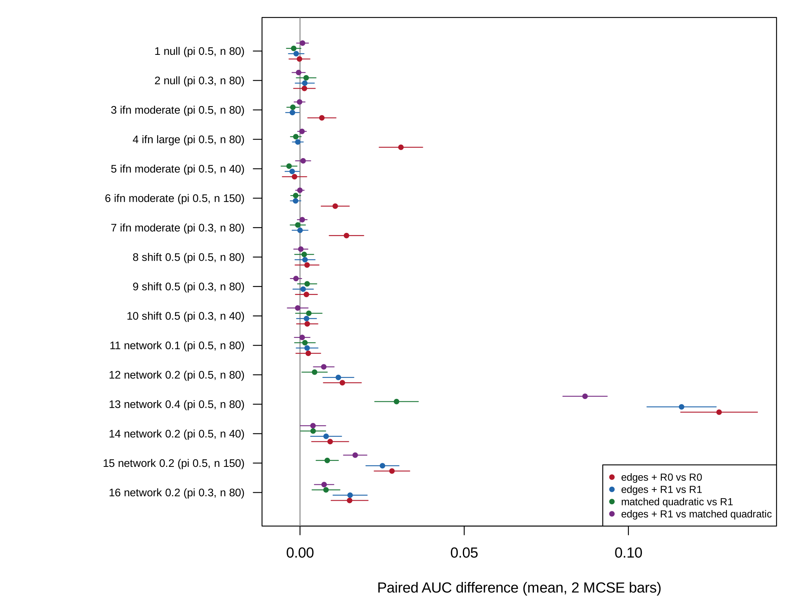

```{r}
#| label: setup
#| include: false

source("../templates/pilot-report/report-helpers.R")
devtools::load_all("..", quiet = TRUE)
s <- readRDS("results/cell_summaries.rds")
v <- readRDS("results/verdict.rds")
ka <- readRDS("results/known_answers.rds")
design <- readRDS("results/design.rds")
run <- readRDS("results/run_info.rds")
timing <- readRDS("results/timing.rds")
dates <- read.csv("gse45291_processing_dates.csv")
cands <- read.csv("candidate_datasets.csv", check.names = FALSE)
G <- function(cell, q) s$mean[s$cell == cell & s$quantity == q]
M <- function(cell, q) s$mcse[s$cell == cell & s$quantity == q]
gm <- function(cell, q, d = 3) sprintf("%s (MCSE %s)", fmt(G(cell, q), d), fmt(M(cell, q), 4))
cl <- v$clauses
q3a <- cl[cl$question == 3 & cl$clause == "(a)", ]
status <- v$status
n_rep <- run$n_rep
minutes <- round(run$elapsed_seconds / 60)
cell_lab <- function(cl) {
  d <- design[design$cell == cl, ]
  if (d$mechanism == "null") return(sprintf("cell %d (null, share %.1f, %d per smaller class)", cl, d$share, d$n1))
  sprintf("cell %d (%s %s, share %.1f, %d in the smaller class)", cl,
          c(ifn = "IFN only", shift = "mean shift", network = "network")[d$mechanism],
          d$level, d$share, d$n1)
}
```

# Summary

**Scope.** This document reports the pilot[^pilot] for the proposal `proposal.md` ("When do LIONESS single-sample networks add information beyond the IFN score in SLE and RA?"): what the idea is, how the pilot was run, what it found, the full draft project spec, and the decisions made along the way. It was built from `project-spec.md`, `decisions.md`, the saved results in `pilot/results/`, and two small files of dataset facts in `pilot/` (`candidate_datasets.csv` and `gse45291_processing_dates.csv`, from GEO records opened on 2026-11-03), and every number in the text and figures is computed from those files when the document renders.

**Status.** In `STATUS.md` the pilot is marked `` `r status` ``[^pf]. STATUS_SENTENCE

| Pilot question | Answer | Key evidence |
|---------|-------------|---------------------------------------------|
| 1. Does the effect exist? | ANSWER1 | Edges added to a reference without the squared IFN score raised the AUC by `r gm(3, "gain_N1R0_vs_R0")` in `r cell_lab(3)`. |
| 2. Large enough at realistic n? | ANSWER2 | The same gain was `r gm(5, "gain_N1R0_vs_R0")` with 40 per class. |
| 3. Obvious fix or diagnostic? | ANSWER3 | Against the matched quadratic model, edges differed by `r fmt_range(q3a$value)` in AUC across the seven IFN-only and mean-shift cells; in the strongest network cell the clause-(b) difference was `r gm(13, "b_clause")`. |

**What needs your decision** (details in [Action items and limitations](#action-items-and-limitations)): the status call; the open `[TO CONFIRM]` items in the spec (highlighted in yellow): the PRECISESADS access request and the milestone dates; and the two open items carried from the proposal (the data contingency, and the check of a supplement for the novelty claim).

# The idea

## In plain language

PLAIN_LANGUAGE

## Potential impact

IMPACT

## Application: the study behind the data

### The study

The proposed data come from PRECISESADS, a European study of systemic autoimmune diseases [@barturen2021precisesads], https://doi.org/10.1002/art.41610. It recruited a cross-sectional cohort of 955 patients with seven systemic autoimmune diseases, among them systemic lupus erythematosus (SLE) and rheumatoid arthritis (RA), and 267 healthy controls, from 18 centres, and measured the whole-blood transcriptome[^transcriptome], the DNA methylome, blood cell proportions by flow cytometry[^flow], and the treatment each patient was taking. Its main finding was that patients cluster into four molecular groups that cut across diagnoses, one of them defined by an interferon (IFN)[^ifn] pattern shared by several diseases. The data are held by ELIXIR Luxembourg under controlled access (dataset ELU-2-E592B0-1, https://doi.org/10.17881/th9v-xt85) for non-commercial research on systemic autoimmune diseases [@precisesads2017data]. Access has not yet been requested, so no PRECISESADS data were opened for this pilot.

A search of the Gene Expression Omnibus[^geo] for public series with both SLE and RA in blood found no usable alternative (@tbl-cohort). The largest, GSE45291, holds both diseases on one platform, but every processing date holds one disease only (@fig-data).

```{r}
#| label: tbl-cohort
#| tbl-cap: "Candidate datasets with SLE and RA from one study, from `candidate_datasets.csv` (GEO series and sample records and the PRECISESADS landing page, opened 2026-11-03). Empty cells: not stated in the record read."

knitr::kable(cands[, c("dataset", "sample_type", "sle", "ra", "controls", "usable", "reason")],
             col.names = c("Dataset", "Samples", "SLE", "RA", "Controls", "Usable", "Reason"),
             row.names = FALSE)
```

### Why the AUC gain over the squared IFN score

The plain-language example says that a LIONESS edge between two IFN genes is mostly the square of how far a patient's IFN activity sits from the average. The quantity that matters is therefore not whether edges separate SLE from RA, which they will whenever IFN does, but how much they add to a model that already holds the IFN score and its square: the gain in the area under the ROC curve[^auc] (AUC) of the model with edges over the reference model, estimated out of sample. The proposed analysis compares 17 models in repeated nested cross-validation[^cv], with two primary contrasts in fixed order: edges against the reference, and edges against the matched quadratic model.

### Did the original study compute it?

No. The PRECISESADS analysis clustered patients on transcriptome and methylome features and characterized the clusters; it built no single-sample networks, fitted no classifier of SLE against RA, and did not separate a network's information from that of the IFN score. The question here is new for these data: whether per-patient networks carry diagnostic information beyond the IFN score, its square, and cell composition.

## In symbols

The sample's standardized expression of gene $i$ ($z_{qi}$, its deviation from the reference mean in units of the reference standard deviation, divisor $N$) and the reference correlation of genes $i$ and $j$ ($r$) determine the LIONESS edge of sample $q$ ($e_q$), with $a = 1/(N-1)$:

$$
\begin{aligned}
e_q &= N r - (N-1)\, \frac{r - a\, z_{qi} z_{qj}}{\sqrt{(1 - a z_{qi}^2)(1 - a z_{qj}^2)}} \\
&= r + z_{qi} z_{qj} - \frac{r}{2}\left(z_{qi}^2 + z_{qj}^2\right) + O_p(1/N).
\end{aligned}
$$

If two genes load on a shared factor ($F$, the IFN activity) with loadings $a_i$ and $a_j$, then $z_{qi} z_{qj} \approx a_i a_j F_q^2$, and the edge carries $F_q^2$. Under a pure mean shift between classes, the class difference in mean edge is

$$
E_1[e] - E_0[e] \approx (1 - 2\pi)\left[\Delta_i \Delta_j - \frac{r}{2}\left(\Delta_i^2 + \Delta_j^2\right)\right].
$$

| Symbol | Meaning |
|----|------------------------------|
| $N$ | number of samples in the reference set |
| $z_{qi}$ | expression of gene $i$ in sample $q$, standardized by the reference (divisor $N$) |
| $r$ | Pearson correlation of genes $i$ and $j$ in the reference |
| $e_q$ | LIONESS edge of sample $q$ for the pair $(i, j)$ |
| $F_q$ | IFN activity of sample $q$ |
| $\pi$ | share of class 1 in the reference |
| $\Delta_i$ | class difference in mean expression of gene $i$, in pooled standard deviations |

What a user wants is the correlation of genes $i$ and $j$ among patients like $q$; what LIONESS computes is the reference correlation plus a quadratic function of $q$'s own expression. A classifier on edges is therefore, to first order, a classifier on the products $z_{qi} z_{qj}$ and squares $z_{qi}^2$, the same information a quadratic expression model uses.

```{r}
#| label: fig-idea
#| fig-cap: "The idea, an illustration on made-up numbers (not pilot output): 200 simulated samples, two genes that each load 0.8 on a factor F, in two classes that differ only in the spread of F. Left: the LIONESS edge of each sample against its squared factor. Right: the same after both genes are adjusted for F."
#| fig-width: 10
#| fig-height: 4.2

set.seed(11)
n <- 200
cls <- rep(0:1, each = n / 2)
f <- rnorm(n, sd = ifelse(cls == 1, 1.5, 0.5))
x <- cbind(0.8 * f + rnorm(n), 0.8 * f + rnorm(n))
e1 <- LionessEdges(x)[, 1]
xr <- x - outer(f, coef(lm(x ~ f - 1)))
e2 <- LionessEdges(xr)[, 1]
par(mfrow = c(1, 2), mar = c(4.2, 4.2, 2, 1))
plot(f^2, e1, col = c("#2166AC", "#B2182B")[cls + 1], pch = 19, cex = 0.6,
     xlab = expression(F^2), ylab = "LIONESS edge", main = "Raw genes")
legend("topleft", c("class 0", "class 1 (larger spread of F)"), col = c("#2166AC", "#B2182B"), pch = 19, cex = 0.8, bty = "n")
plot(f^2, e2, col = c("#2166AC", "#B2182B")[cls + 1], pch = 19, cex = 0.6,
     xlab = expression(F^2), ylab = "LIONESS edge", main = "Genes adjusted for F")
```

```{r}
#| label: fig-data
#| fig-cap: "Real data: GSE45291, the largest public series with SLE and RA in whole blood. Each bar is one processing date (read from the date prefix of the sample titles) and its samples by group, from `gse45291_processing_dates.csv`. No date holds more than one group."
#| fig-width: 9
#| fig-height: 4.2

tab <- xtabs(n_samples ~ date_from_title + group, data = dates)
par(mar = c(6.5, 4.2, 1, 1))
barplot(t(tab), las = 2, cex.names = 0.7, col = c("grey60", "#1B7837", "#B2182B", "#2166AC"),
        ylab = "Samples", legend.text = colnames(tab), args.legend = list(x = "topleft", bty = "n", cex = 0.8))
```

## Critiquing the model



| Feature of the model | Why it may not be realistic | What should be done to check it |
|-----------|----------------------------------------------|---------------------------------|
| Gaussian noise $\varepsilon$ and Gaussian $F$ | Expression on the log scale has heavier tails than normal, and the first-order form of $e_q$ is unbounded in $z$, so a few outlying samples can dominate the edges | Repeat the IFN-only cells with $t$-distributed noise and with real-data residuals resampled in place of $\varepsilon$ |
| One factor $F$ with equal loadings $a_g$ = 0.8 on 20 genes | Real IFN-stimulated genes respond with different strengths and to different IFN types, so $F$ is several correlated factors | Estimate the loadings and the number of IFN factors from PRECISESADS and simulate with them |
| The IFN score as the mean of five genes | The score measures $F$ with error, so $R_1$ cannot remove all of $F^2$; the size of the left-over depends on the score's reliability | Vary the number of score genes and their loadings, and report the gain of edges over $R_1$ as a function of the score's reliability |
| Composition $C$ as one factor, observed without error | Whole blood has several cell types whose shares are measured or estimated with error, and their squares enter the edges as $F^2$ does | Use the flow-cytometry proportions of PRECISESADS, with several cell types, and compare measured with estimated composition |
| Class differences confined to one mechanism per cell | SLE and RA differ in IFN, means, and co-expression at once | Simulate combined mechanisms at the sizes estimated from the data |
| The parameter values (shift, spread ratio, correlation change) | They are chosen to span small to large effects, not estimated from blood | Place PRECISESADS on each gradient: estimate the IFN difference between SLE and RA and the co-expression differences of the strongest modules |
| A fixed gene set of 45 genes, 990 edges | Studies select genes by variance or pathway, often after looking at the data, and use thousands of edges | Repeat with selection by variance inside each training fold and with larger gene sets |
| Independent samples, one per patient | Some cohorts have repeated samples or family structure | Use one sample per patient in the application |

# Methods

## Design

The pilot simulates two classes of 50 genes in 16 cells. Genes 1 to 20 load on an IFN factor $F$, genes 1 to 5 form the IFN score, genes 21 to 30 form a co-expressed module, and genes 31 to 50 load on a composition factor $C$. Each cell lets the classes differ in one way only: not at all (null), in the distribution of $F$ (IFN only), in the means of the module genes (mean shift), or in the module's correlation (network). In each replicate, seven models are fitted in an outer 5-fold cross-validation, with every derived quantity (the IFN score and its residual, the standardization, the LIONESS reference) computed inside the training fold.

```{r}
#| label: fig-design
#| fig-cap: "The design at a glance. Each row is one part of the pilot, read from left to right: what is simulated, which factors are varied, what is estimated, what is measured, and how the result is shown. The input is a simulated cohort of 50 genes with an IFN factor, a composition factor, and a co-expressed module. Every part feeds the AUC table (@tbl-auc) and the figure of gains (@fig-gains); the verdict is in @tbl-verdict, and the known-answer checks in @tbl-known-answer."
#| fig-width: 11
#| fig-height: 5.6

design_diagram(
  input = "Simulated cohort: 50 genes; IFN factor F on genes 1-20 (score: genes 1-5); module of genes 21-30; composition C on genes 31-50",
  lanes = list(
    list(label = "Part A: null and IFN only", fill = "#e8f0fa", sim = "Classes differ in the mean and spread of F, or not at all", vary = "IFN difference; class share; class size", est = "AUC of R0, R1, E1, E4, E5, edges + R0, edges + R1", meas = "Gain of edges over R0 and over the matched quadratic model", out = "Questions 1, 2, 3(a): AUC table, gains figure"),
    list(label = "Part B: mean shift", fill = "#fdeceb", sim = "Class 1 shifted 0.5 SD on the module genes", vary = "Class share; class size", est = "The same seven models; class difference in mean edge", meas = "Edges against the matched quadratic model; edge difference against equation (3)", out = "Question 3(a); known-answer table"),
    list(label = "Part C: network", fill = "#eaf5ea", sim = "Module correlation 0.3 in class 0, higher in class 1", vary = "Correlation change; class share; class size", est = "The same seven models", meas = "Share of the edges' gain reached by the matched quadratic model", out = "Question 3(b): AUC table, gains figure")),
  harness = list(text = "Known-answer checks: exact edge = leave-one-out LIONESS; add-one edge = definition; AUC on known cases;\nnull cells give AUC 0.5; mean-shift edge difference = equation (3)", out = "Known-answer table"))
```

Each figure and table in the Results traces back to one row of this diagram, and the row says what its points or entries represent.

| Part | What is simulated | Main factors | Replicates |
|----|-------------------------|-------------------------|----------|
| A | Null (cells 1, 2) and IFN only (cells 3 to 7) | IFN difference (moderate, large), share 0.5 or 0.3, smaller class 40, 80, or 150 | `r n_rep` per cell |
| B | Mean shift of 0.5 SD on the module (cells 8 to 10) | share 0.5 or 0.3, smaller class 40 or 80 | `r n_rep` per cell |
| C | Module correlation change (cells 11 to 16) | change 0.1, 0.2, 0.4; share; class size | `r n_rep` per cell |

The seven models are: $R_0$, logistic regression on age, sex, composition, and the residual IFN score; $R_1$, $R_0$ plus the squared residual score and squared composition; E1, an elastic net[^enet] on the 45 non-score genes; E4, regularized discriminant analysis[^rda] on the genes, the residual score, and composition; E5, the matched quadratic model, an elastic net on the 990 pairwise products and 45 squares of the standardized genes; and the edge models, an elastic net on the 990 LIONESS edges of the same genes, with $R_0$ or with $R_1$. In every elastic net the reference covariates are unpenalized, so the added features must improve on them. The moderate IFN difference shifts the mean of $F$ by 0.5 standard deviations and multiplies its spread by 1.5 in class 1; the large one shifts it by 1 and multiplies the spread by 2.25.

## Known-answer checks



```{r}
#| label: tbl-known-answer
#| tbl-cap: "Known-answer checks, from `results/known_answers.rds`."

rows <- lapply(seq_len(nrow(ka)), function(i) {
  k <- ka[i, ]
  if (k$type == "identity") {
    tol <- if (grepl("First-order", k$check)) 0.05 else 1e-8
    harness_row(k$check, k$setting, fmt(k$known, 3), formatC(k$computed, format = "g", digits = 3),
                harness_reading_tol(k$computed, k$known, tol))
  } else {
    harness_row(k$check, k$setting, fmt(k$known, 3), sprintf("%s (MCSE %s)", fmt(k$computed, 4), fmt(k$mcse, 4)),
                harness_reading_mcse(k$computed, k$known, k$mcse))
  }
})
harness_table(rows)
```

`r harness_flag_summary((ka$computed - ka$known)[ka$type == "mcse"] / ka$mcse[ka$type == "mcse"])`

# Results

## How to read the outputs



This pilot reports AUC and paired AUC differences. A paired difference is computed within each replicate, between two models fitted to the same simulated cohort, and then averaged; its MCSE is the replicate standard deviation of the difference divided by the square root of the number of replicates. A difference of 0 means the added features carried no information.

## AUC gains by cell

**Figure guide (all parts).** Each row is one cell of the design, labelled by its mechanism, level, share of the smaller class ($\pi$), and size of the smaller class ($n$). The four colored points are four paired AUC differences averaged over `r n_rep` replicates: edges with $R_0$ against $R_0$, edges with $R_1$ against $R_1$, the matched quadratic model against $R_1$, and edges with $R_1$ against the matched quadratic model. The bars are two MCSE on each side, and the grey line is no difference. In the null cells every point should sit on the line. Look for: where the red points leave the line and the blue points do not; whether the purple points stay on the line in the IFN-only and mean-shift cells; how the green and blue points compare in the network cells.

```{r}
#| label: fig-gains
#| fig-cap: "Pilot result (all parts): paired AUC differences by cell, means over replicates with bars of two MCSE, from `results/cell_summaries.rds`."
#| fig-width: 10
#| fig-height: 7.5


```

## Numbered findings

Each finding is a claim followed by the output behind it. Read the claim, open the output, and check that you can see the claim there before accepting it. A claim that cannot be seen in the output is a question to raise with the user.

FINDINGS

## Tables

**Table guide (all parts).** One row per cell; the columns are the mean out-of-fold AUC of each model over `r n_rep` replicates. The reference value is 0.5 in the null cells. Compare the edge models with $R_0$ and $R_1$ in the same row, and with E5. Which cells show a gap between edges with $R_0$ and edges with $R_1$, and is it the same size as the gap between $R_0$ and $R_1$?

```{r}
#| label: tbl-auc
#| tbl-cap: "Mean out-of-fold AUC by cell and model, from `results/cell_summaries.rds`. The largest MCSE of any entry is given in the text below the table."

models <- c("R0", "R1", "E1", "E4", "E5", "N1R0", "N1R1")
tab <- data.frame(Cell = sapply(design$cell, cell_lab))
for (m in models) tab[[m]] <- fmt(sapply(design$cell, G, q = m), 3)
names(tab) <- c("Cell", "R0", "R1", "E1 (genes)", "E4 (RDA)", "E5 (quadratic)", "Edges + R0", "Edges + R1")
knitr::kable(tab, row.names = FALSE)
```

The largest MCSE of an AUC in the table is `r fmt(max(s$mcse[s$quantity %in% models]), 4)`.

**Table guide (the verdict).** One row per clause of the pre-registered rule: the quantity, its value with its MCSE, the threshold, and the outcome, read by `pilot/verdict.R`. Check that each outcome follows from its value and threshold, and that the combination gives the status.

```{r}
#| label: tbl-verdict
#| tbl-cap: "The pass rule applied clause by clause, from `results/verdict.rds`."

vt <- cl
vt$cell <- sapply(vt$cell, cell_lab)
vt$value <- fmt(vt$value, 4)
vt$mcse <- fmt(vt$mcse, 4)
knitr::kable(vt[, c("question", "clause", "cell", "quantity", "value", "mcse", "threshold", "outcome")],
             col.names = c("Q", "Clause", "Cell", "Quantity", "Value", "MCSE", "Threshold", "Outcome"),
             row.names = FALSE)
```

**Table guide (numbers quoted in the spec).** Each row recomputes a number that section 3 of the spec quotes, from the result files. Each should match the spec exactly.

```{r}
#| label: tbl-spec-numbers
#| tbl-cap: "Numbers quoted in the spec's section 3, recomputed from `results/cell_summaries.rds` and `results/verdict.rds`."

knitr::kable(data.frame(
  Quantity = c("Question 1: gain of edges + R0 over R0, cell 3",
               "Question 2: gain of edges + R0 over R0, cell 5",
               "Question 3(a): range of A(edges + R1) - A(E5) over cells 3 to 10",
               "Question 3(b): clause value, cell 13",
               "Status"),
  Value = c(gm(3, "gain_N1R0_vs_R0", 4), gm(5, "gain_N1R0_vs_R0", 4),
            fmt_range(q3a$value, 4), gm(13, "b_clause", 4), status)), row.names = FALSE)
```

# The draft spec {#draft-spec}

This is `project-spec.md`, read from the file when the document renders. Anything the agent[^agent] left for the user to decide is highlighted in yellow and starts with "To confirm".

```{r}
#| label: spec
#| results: asis

cat(read_md_part("../project-spec.md", highlight_to_confirm = TRUE), "\n")
```

# Decisions log {#decisions-log}

This is the agent's `decisions.md`, read from the file when the document renders.

```{r}
#| label: decisions
#| results: asis

cat(read_md_part("decisions.md"), "\n")
```

# Action items and limitations {#action-items-and-limitations}

## Action items

ACTIONS

## Limitations

LIMITATIONS



[^transcriptome]: The transcriptome is the set of RNA molecules in a sample; here, the expression level of each gene in whole blood, measured by RNA sequencing.

[^flow]: Flow cytometry counts cells by their surface markers, which gives the proportions of B cells, T cells, monocytes, and neutrophils in a blood sample.

[^ifn]: Type I interferons are signaling proteins of the immune response; many SLE patients, and some RA patients, have high blood expression of the genes they induce (the IFN signature), summarized by an IFN score.

[^geo]: The Gene Expression Omnibus is the public archive of gene expression data run by the US National Center for Biotechnology Information.

[^auc]: The area under the ROC curve is the probability that a randomly chosen SLE patient gets a higher score than a randomly chosen RA patient; 0.5 is chance and 1 is perfect separation.

[^cv]: In cross-validation the data are split into folds, each model is fitted without one fold and scored on it, and the scores are pooled; nested cross-validation tunes the model inside each training part, so that the held-out fold is never used for any choice.

[^enet]: The elastic net is logistic regression with a penalty that shrinks coefficients and sets many to zero, so it can use more features than samples; glmnet is the R package that fits it.

[^rda]: Regularized discriminant analysis classifies with a separate covariance matrix per class, shrunk toward a pooled one and toward a diagonal, which gives a quadratic decision rule (quadratic discriminant analysis) when the shrinkage is small.
